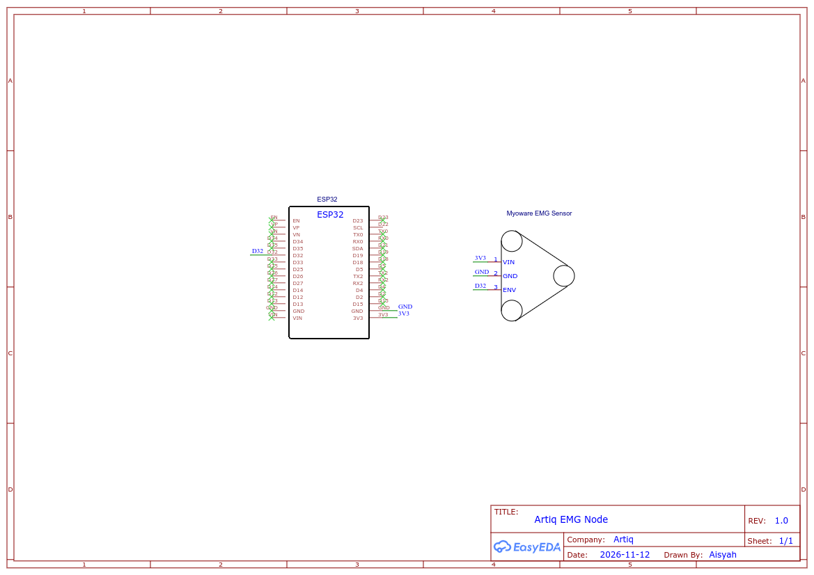

<p align="center">
  
</p>

<h1 align="center">ArtiQ</h1>

<p align="center">
  <b>Smart AR Hand Physiotherapy &amp; Wireless MyoWare 2.0 EMG Biofeedback Platform</b>
</p>

<p align="center">
  <a href="esp32/PINOUT_AND_WIRING.md"></a>
  <a href="ArtiQ/SECURITY_AND_ARCHITECTURE.md"></a>
  <a href="ArtiQ/API_DOCUMENTATION.md"></a>
  <a href="ArtiQ/DOCKER_AND_SERVICES.md"></a>
  <a href="esp32/MQTT_SPECIFICATION.md"></a>
  <a href="ArtiQ/DOCKER_AND_SERVICES.md"></a>
</p>

> **ArtiQ** is an interactive smart physiotherapy rehabilitation platform combining **client-side MediaPipe Hands AR tracking** with an **ESP32 + MyoWare 2.0 wireless surface EMG biofeedback node**. It delivers real-time `%MVC` muscle activation telemetry over **MQTT**, green-screen Chroma Key exercise guidance, and clinical session logging inside an Apple-grade **Liquid Glass** desktop web portal backed by **FastAPI**, **PostgreSQL 15**, and **Resend OTP** security.

---

## 📑 Language Options / Pilihan Bahasa
* 🇬🇧 **[English Documentation (Current)](README.md)**
* 🇲🇾 **[Dokumentasi Bahasa Melayu](README_MY.md)**

---

## 🏛️ High-Level System Architecture

```text
+---------------------------------------------------------------------------------------------------+
|                                      ARTIQ SYSTEM ARCHITECTURE                                    |
+---------------------------------------------------------------------------------------------------+

      [ CLINICAL EDGE HARDWARE ]                                      [ CLOUD & SERVER STACK ]
      Folder: esp32/                                                  Folder: ArtiQ/

 +----------------------------------+                            +----------------------------------+
 |       ESP32 EMG SENSOR NODE      |                            |        ECLIPSE MOSQUITTO         |
 |  - MyoWare 2.0 (ENV Pin @ GPIO32)|    MQTT (TCP / Port 1883)  |       MQTT BROKER (v2.0)         |
 |  - 12-bit Oversampled ADC (1kHz) | <========================> |  - artiq/emg/data/{MAC} (20 Hz)  |
 |  - Attack/Decay Envelope Filter  |     KeepAlive 15s / LWT    |  - artiq/emg/status/{MAC} (LWT)  |
 |  - Auto Baseline & 3s MVC Peak   |                            |  - artiq/emg/command/{MAC}       |
 +----------------------------------+                            +----------------------------------+
                                                                                  |
                                                                                  v
 +----------------------------------+                            +----------------------------------+
 |   DESKTOP BROWSER EDGE AI CLIENT |                            |       FASTAPI BACKEND (8830)     |
 |  - MediaPipe Hands 21-Landmarks  |   HTTPS + HttpOnly JWT     |  - Modular App (Core/API/Models) |
 |  - Euclidean Grip Rep Counter    | <========================> |  - Security Headers & CSRF Guard |
 |  - Chroma Key Guide Video Engine |   50ms Telemetry Polling   |  - Rate Limit & 15m Lockout      |
 |  - Liquid Glass UI (Min 900px)   |                            |  - Resend 6-Digit OTP Dispatcher |
 +----------------------------------+                            +----------------------------------+
                                                                           |              |
                                                                           v              v
                                                                 +--------------+  +----------------+
                                                                 | POSTGRESQL 15|  |   RESEND API   |
                                                                 |  (Port 5450) |  | mail.flowkraft |
                                                                 | Asia/KL (+8) |  | OTP + CID Logo |
                                                                 +--------------+  +----------------+
```

---

## 🔌 Hardware Circuit & Wiring Schematic

The physical wiring for the **ArtiQ EMG Node** (Rev 1.0)—interconnecting the **ESP32** microcontroller and **MyoWare 2.0 Muscle Sensor**—is verified in the circuit schematic below:

<p align="center">
  
</p>

* 📄 **Download Printable Schematic PDF:** [`Schematic_artiq_2026-11-12.pdf`](Schematic_artiq_2026-11-12.pdf)
* 📄 **Detailed Wiring & Pinout Guide:** [`esp32/PINOUT_AND_WIRING.md`](esp32/PINOUT_AND_WIRING.md)

### Hardware Pinout Summary Table

| Subsystem | Component / Pin | ESP32 GPIO | Operating Voltage | Signal Description |
|---|---|---|---|---|
| **Power Supply** | MyoWare 2.0 `VIN` (Pin 1) | **3V3** | `3.3V DC` | Regulated 3.3V output from ESP32 onboard LDO |
| **Ground** | MyoWare 2.0 `GND` (Pin 2) | **GND** | `0V` | Common ground reference |
| **EMG Envelope** | MyoWare 2.0 `ENV` (Pin 3) | **GPIO 32 (D32)** | `0.0V – 3.3V` Analog | `ADC1_CH4` 12-bit (`0–4095`) hardware-rectified envelope |

---

## ✨ Key Features & Algorithmic Highlights

### 1. MyoWare 2.0 1000Hz Envelope & `%MVC` Normalization
* Samples the MyoWare 2.0 `ENV` pin at `1000 Hz` on Wi-Fi-safe `ADC1_CH4` (`GPIO 32`) using an 8-sample oversampling filter (`readSmoothedADC()`) to eliminate ADC spike jitter.
* Auto-calibrates the resting muscle `baseline` (`0%`) at boot and captures the 3-second Maximum Voluntary Contraction (`mvcValue`) peak via remote `"calibrate"` command, streaming normalized `%MVC` (`0–150%`) to the portal at `20 Hz`.

### 2. Client-Side MediaPipe Hands AR Rep Counter
* Processes desktop webcam feeds locally in the browser with **MediaPipe Hands** (zero video uploaded to servers).
* Computes the average Euclidean distance from wrist (`landmark 0`) to index (`8`), middle (`12`), and ring (`16`) fingertips: engaging grip below `0.15` and counting a completed repetition on release above `0.20` with an `800 ms` anti-ghosting cooldown.

### 3. Real-Time Chroma Key Exercise Guidance
* Composites `guide.mp4` dynamically onto an HTML5 `<canvas>` via per-pixel alpha green-screen masking so patients follow target grip form alongside live AR landmarks.

### 4. Bidirectional MQTT & Hardware LWT Watchdog
* ESP32 nodes register a retained **Last Will and Testament (LWT)** on `artiq/emg/status/{MAC}` (`"online"` / `"offline"`), allowing the dashboard to reflect hardware connectivity instantaneously.

### 5. Modular FastAPI Security & Liquid Glass Desktop Portal
* Implements Bcrypt password hashing, HS256 JWT `HttpOnly`/`Secure`/`SameSite=Lax` cookies, cryptographic 6-digit Resend OTPs (10-minute expiry, 5 max attempts, single-use) for registration and password reset, 15-minute brute-force account lockout, CSRF `Origin`/`Referer` validation, HTTP security headers, and `Asia/Kuala_Lumpur` (GMT+8) synchronization.
* Includes a **Liquid Glass Mobile Blocker** (`<= 900 px`), dedicated `privacy.html`, branded `404.html`, `robots.txt`, `sitemap.xml`, and `llms.txt`.

---

## 📂 Repository Structure

```text
.
├── README.md                           # Master Project Documentation (English)
├── README_MY.md                        # Master Project Documentation (Bahasa Melayu)
├── Schematic_artiq_2026-11-12.png      # Rendered Hardware Circuit Schematic
├── Schematic_artiq_2026-11-12.pdf      # Printable Hardware CAD Schematic (Rev 1.0)
├── logo.svg                            # Vector Project Logo
├── favicon.svg                         # Vector Browser Favicon
├── favicon.ico                         # Multi-Resolution ICO Favicon
├── .env.example                        # Environment Variable Template
├── .gitignore                          # Git Exclusion Rules
│
├── esp32/                              # ESP32 Firmware & Hardware Documentation
│   ├── README.md / README_MY.md        # Hardware Overview & BOM
│   ├── PINOUT_AND_WIRING.md / _MY.md   # Pinout Table, Electrodes & Safety
│   ├── MQTT_SPECIFICATION.md / _MY.md  # Topics, JSON Payloads & LWT Protocol
│   ├── FLASHING_AND_SETUP.md / _MY.md  # Toolchain, Libraries & Pairing Guide
│   └── artiq_emg_node/
│       └── artiq_emg_node.ino          # Production MyoWare 2.0 Firmware Sketch
│
└── ArtiQ/                              # Containerized Server & Liquid Glass Web Stack
    ├── README.md / README_MY.md        # Server Stack Overview
    ├── API_DOCUMENTATION.md / _MY.md   # REST Endpoints & JSON Envelopes
    ├── DOCKER_AND_SERVICES.md / _MY.md # Docker Topology, Ports & Timezone
    ├── SECURITY_AND_ARCHITECTURE.md / _MY.md # Auth, CSRF, Lockout & Edge AI Logic
    ├── docker-compose.yml              # 3-Container Orchestration (DB, API, MQTT)
    ├── .env.example                    # Container Environment Template
    ├── mosquitto/config/mosquitto.conf # Mosquitto Broker Configuration
    ├── backend/                        # Modular FastAPI Application (Non-Root Docker)
    │   ├── Dockerfile
    │   ├── requirements.txt
    │   └── app/
    │       ├── main.py
    │       ├── core/                   # Config, Database, Security, Middleware
    │       ├── models/                 # User, OTPRecord, ExerciseSession
    │       ├── schemas/                # Auth, Session & Common Response Schemas
    │       ├── api/                    # Dependencies & v1 Routers (Auth, Sessions, EMG, Health)
    │       └── services/               # Resend Email & MQTT Telemetry Engine
    └── frontend/                       # Liquid Glass Clinical Web Portal
        ├── index.html                  # Auth Wall + Desktop Webcam AR Dashboard
        ├── privacy.html                # Privacy Policy Page
        ├── 404.html                    # Custom Branded 404 Page
        ├── style.css                   # Liquid Glass Optics & Mobile Blocker
        ├── app.js                      # MediaPipe Hands, Chroma Key & Telemetry Polling
        ├── logo.png / favicon.ico / favicon.svg
        ├── guide.mp4
        ├── robots.txt / sitemap.xml / llms.txt
```

---

## 📖 Subsystem Documentation Directory

### 🔌 Embedded Hardware (`esp32/`)
* 🧰 **Hardware Overview & BOM:** [English](esp32/README.md) • [Bahasa Melayu](esp32/README_MY.md)
* ⚡ **Pinout & Wiring Guide:** [English](esp32/PINOUT_AND_WIRING.md) • [Bahasa Melayu](esp32/PINOUT_AND_WIRING_MY.md)
* 📡 **MQTT Protocol & LWT:** [English](esp32/MQTT_SPECIFICATION.md) • [Bahasa Melayu](esp32/MQTT_SPECIFICATION_MY.md)
* 💾 **Flashing & Setup Guide:** [English](esp32/FLASHING_AND_SETUP.md) • [Bahasa Melayu](esp32/FLASHING_AND_SETUP_MY.md)

### 🐳 Server, Docker & Web Stack (`ArtiQ/`)
* 🧩 **Server Stack Overview:** [English](ArtiQ/README.md) • [Bahasa Melayu](ArtiQ/README_MY.md)
* 🌐 **RESTful API Reference:** [English](ArtiQ/API_DOCUMENTATION.md) • [Bahasa Melayu](ArtiQ/API_DOCUMENTATION_MY.md)
* 🚢 **Docker & Services:** [English](ArtiQ/DOCKER_AND_SERVICES.md) • [Bahasa Melayu](ArtiQ/DOCKER_AND_SERVICES_MY.md)
* 🔒 **Security & Edge AI Architecture:** [English](ArtiQ/SECURITY_AND_ARCHITECTURE.md) • [Bahasa Melayu](ArtiQ/SECURITY_AND_ARCHITECTURE_MY.md)

---

## 🚀 Quick Start Guide

### 1. Deploy the Server & MQTT Stack
```bash
cd ArtiQ
cp .env.example .env
# Edit .env with PostgreSQL credentials, RESEND_API_KEY, and SECRET_KEY
docker network inspect pwn20wnd-network >/dev/null 2>&1 || docker network create pwn20wnd-network
docker compose up -d --build
```

### 2. Flash & Provision the ESP32 MyoWare 2.0 Node
1. Install `PubSubClient` and `WiFiManager` (by tzapu) in Arduino IDE, then configure `mqtt_server` in [`esp32/artiq_emg_node/artiq_emg_node.ino`](esp32/artiq_emg_node/artiq_emg_node.ino).
2. Flash to your ESP32 (`GPIO 32` connected to MyoWare 2.0 `ENV` at `3.3V`). If no saved Wi-Fi is found within `20 seconds`, connect to the **`ArtiQ-EMG-Setup`** captive portal to enter your Wi-Fi credentials, then note the MAC address printed on Serial Monitor (`115200 baud`).

### 3. Open the Clinical Dashboard
1. Visit `http://localhost:8830` on a desktop/laptop browser (`>= 900 px` width with webcam access).
2. Register an admin account with 6-digit email OTP verification and sign in.
3. Open **Settings**, link your ESP32 MAC address, and click **Calibrate** to capture your 3-second MVC peak.

---

## 📜 License
* Developed for **Educational Purposes Only**.
