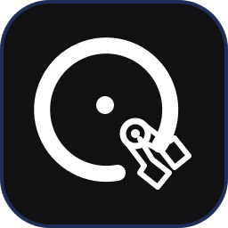
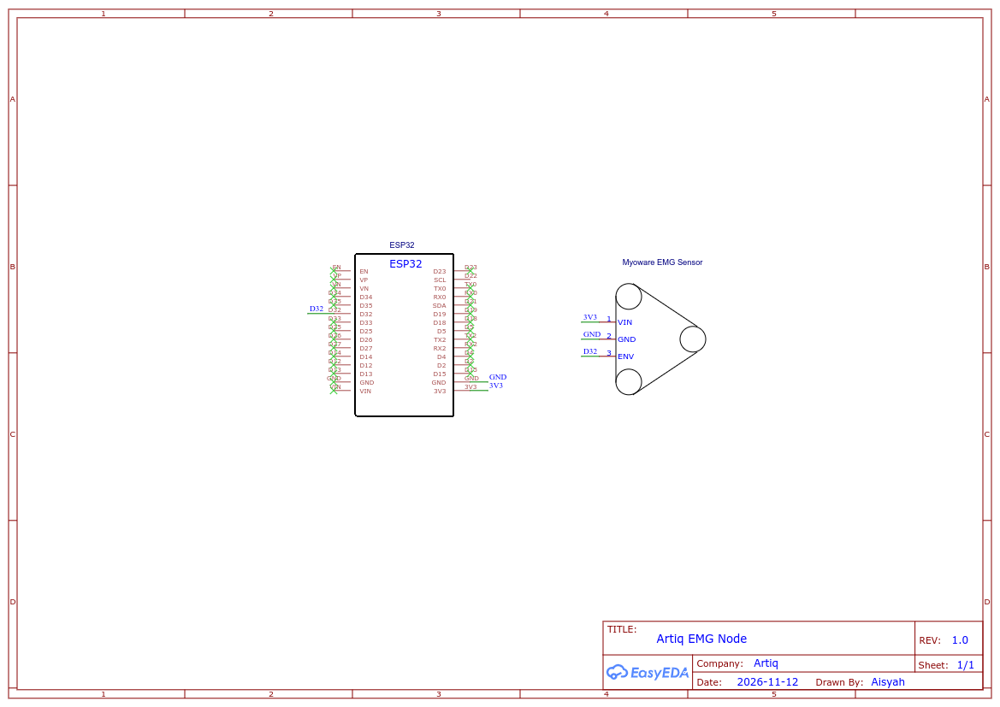

<p align="center">
  
</p>

<h1 align="center">ArtiQ</h1>

<p align="center">
  <b>Platform Fisioterapi Tangan AR Pintar &amp; Bioumpan Balik EMG MyoWare 2.0 Tanpa Wayar</b>
</p>

<p align="center">
  <a href="esp32/PINOUT_AND_WIRING_MY.md"></a>
  <a href="ArtiQ/SECURITY_AND_ARCHITECTURE_MY.md"></a>
  <a href="ArtiQ/API_DOCUMENTATION_MY.md"></a>
  <a href="ArtiQ/DOCKER_AND_SERVICES_MY.md"></a>
  <a href="esp32/MQTT_SPECIFICATION_MY.md"></a>
  <a href="ArtiQ/DOCKER_AND_SERVICES_MY.md"></a>
</p>

> **ArtiQ** ialah platform pemulihan fisioterapi pintar interaktif yang menggabungkan **penjejakan AR MediaPipe Hands di pelayar** dengan **nod bioumpan balik EMG permukaan tanpa wayar ESP32 + MyoWare 2.0**. Sistem ini menyalurkan telemetri pengaktifan otot `%MVC` masa nyata melalui **MQTT**, panduan senaman *Chroma Key*, dan rekod sesi klinikal di dalam portal desktop **Liquid Glass** yang dikuasakan oleh **FastAPI**, **PostgreSQL 15**, dan pengesahan OTP **Resend**.

---

## 📑 Pilihan Bahasa / Language Options
* 🇬🇧 **[English Documentation](README.md)**
* 🇲🇾 **[Dokumentasi Bahasa Melayu (Semasa)](README_MY.md)**

---

## 🏛️ Seni Bina Sistem Aras Tinggi

```text
+---------------------------------------------------------------------------------------------------+
|                                     SENI BINA SISTEM ARTIQ                                        |
+---------------------------------------------------------------------------------------------------+

      [ PERKAKASAN EDGE KLINIKAL ]                                    [ TINDANAN PELAYAN & AWAN ]
      Folder: esp32/                                                  Folder: ArtiQ/

 +----------------------------------+                            +----------------------------------+
 |        NOD SENSOR EMG ESP32      |                            |        ECLIPSE MOSQUITTO         |
 |  - MyoWare 2.0 (Pin ENV @ GPIO32)|    MQTT (TCP / Port 1883)  |       BROKER MQTT (v2.0)         |
 |  - ADC 12-bit Purata (1000 Hz)   | <========================> |  - artiq/emg/data/{MAC} (20 Hz)  |
 |  - Penapis Sampul Attack/Decay   |     KeepAlive 15s / LWT    |  - artiq/emg/status/{MAC} (LWT)  |
 |  - Garis Dasar Auto & Puncak MVC |                            |  - artiq/emg/command/{MAC}       |
 +----------------------------------+                            +----------------------------------+
                                                                                  |
                                                                                  v
 +----------------------------------+                            +----------------------------------+
 |  KLIEN EDGE AI PELAYAR DESKTOP   |                            |       BACKEND FASTAPI (8830)     |
 |  - MediaPipe Hands 21-Titik      |   HTTPS + Kuki JWT HttpOnly|  - App Modular (Core/API/Models) |
 |  - Pengira Ulangan Genggaman     | <========================> |  - Header Keselamatan & CSRF     |
 |  - Enjin Video Panduan ChromaKey |   Tinjauan Telemetri 50ms  |  - Had Kadar & Kunci Akaun 15m   |
 |  - UI Liquid Glass (Min 900px)   |                            |  - Penghantar OTP 6-Digit Resend |
 +----------------------------------+                            +----------------------------------+
                                                                           |              |
                                                                           v              v
                                                                 +--------------+  +----------------+
                                                                 | POSTGRESQL 15|  |   RESEND API   |
                                                                 |  (Port 5450) |  | mail.flowkraft |
                                                                 | Asia/KL (+8) |  | OTP + Logo CID |
                                                                 +--------------+  +----------------+
```

---

## 🔌 Skematik Litar & Pendawaian Perkakasan

Pendawaian fizikal untuk **Nod EMG ArtiQ** (Rev 1.0)—yang menyambungkan mikropengawal **ESP32** dan **Sensor Otot MyoWare 2.0**—adalah seperti yang ditunjukkan pada skematik di bawah:

<p align="center">
  
</p>

* 📄 **Muat Turun PDF Skematik Boleh Cetak:** [`Schematic_artiq_2026-11-12.pdf`](Schematic_artiq_2026-11-12.pdf)
* 📄 **Panduan Terperinci Pinout & Pendawaian:** [`esp32/PINOUT_AND_WIRING_MY.md`](esp32/PINOUT_AND_WIRING_MY.md)

### Jadual Ringkasan Pinout Perkakasan

| Subsistem | Komponen / Pin | GPIO ESP32 | Voltan Operasi | Penerangan Isyarat |
|---|---|---|---|---|
| **Bekalan Kuasa** | MyoWare 2.0 `VIN` (Pin 1) | **3V3** | `3.3V DC` | Output kuasa 3.3V teratur daripada LDO ESP32 |
| **Bumi (*Ground*)** | MyoWare 2.0 `GND` (Pin 2) | **GND** | `0V` | Rujukan bumi sepunya |
| **Sampul EMG** | MyoWare 2.0 `ENV` (Pin 3) | **GPIO 32 (D32)** | Analog `0.0V – 3.3V` | Input `ADC1_CH4` 12-bit (`0–4095`) isyarat sampul terterus |

---

## ✨ Ciri Utama & Kelebihan Algoritma

### 1. Sampul MyoWare 2.0 1000Hz & Penormalan `%MVC`
* Mengambil bacaan pin `ENV` MyoWare 2.0 pada kadar `1000 Hz` menerusi saluran `ADC1_CH4` (`GPIO 32`) yang kalis gangguan Wi-Fi dengan penapis purata 8 sampel (`readSmoothedADC()`).
* Menetapkan garis dasar rehat (`0%`) secara automatik semasa boot dan merakam puncak *Maximum Voluntary Contraction* (`mvcValue`) selama 3 saat melalui arahan `"calibrate"`, lalu menyalurkan `%MVC` (`0–150%`) ke papan pemuka pada kadar `20 Hz`.

### 2. Pengiraan Ulangan Genggaman AR MediaPipe Hands di Pelayar
* Memproses strim kamera web desktop 100% secara tempatan di pelayar menggunakan **MediaPipe Hands** tanpa memuat naik video ke pelayan.
* Mengira purata jarak Euclidean dari pergelangan tangan (`landmark 0`) ke hujung jari telunjuk (`8`), jari hantu (`12`), dan jari manis (`16`): status `GRIPPING` diaktifkan di bawah `0.15` dan ulangan dikira apabila tangan dibuka melebihi `0.20` dengan penyejukan `800 ms`.

### 3. Panduan Senaman Chroma Key Masa Nyata
* Video panduan `guide.mp4` digabungkan ke `<canvas>` HTML5 menggunakan penapisan alfa latar hijau masa nyata supaya pesakit dapat meniru postur sasaran dengan jelas.

### 4. MQTT Dua Hala & Pengawasan LWT Perkakasan
* Setiap nod ESP32 mendaftarkan **Last Will and Testament (LWT)** pada topik `artiq/emg/status/{MAC}` (`"online"` / `"offline"`) supaya papan pemuka mengesan sambungan peranti secara serta-merta.

### 5. Keselamatan Backend Modular & Portal Desktop Liquid Glass
* Mengaplikasikan pencincangan kata laluan Bcrypt, kuki JWT HS256 `HttpOnly`/`Secure`/`SameSite=Lax`, OTP 6-digit kriptografi (luput 10 minit, maks 5 cubaan, guna-sekali) untuk pendaftaran dan tetapan semula kata laluan, penguncian akaun 15 minit, perlindungan CSRF `Origin`/`Referer`, header keselamatan HTTP, dan zon masa `Asia/Kuala_Lumpur` (GMT+8).
* Turut dilengkapi **Liquid Glass Mobile Blocker** (`<= 900 px`), halaman `privacy.html`, `404.html`, `robots.txt`, `sitemap.xml`, dan `llms.txt`.

---

## 📂 Struktur Repositori

```text
.
├── README.md                           # Dokumentasi Utama Projek (Bahasa Inggeris)
├── README_MY.md                        # Dokumentasi Utama Projek (Bahasa Melayu)
├── Schematic_artiq_2026-11-12.png      # Gambar Rajah Skematik Litar Perkakasan
├── Schematic_artiq_2026-11-12.pdf      # Skematik CAD Boleh Cetak (Rev 1.0)
├── logo.svg                            # Logo Vektor Projek
├── favicon.svg                         # Favicon Vektor Pelayar
├── favicon.ico                         # Favicon ICO Pelbagai Resolusi
├── .env.example                        # Templat Pemboleh Ubah Persekitaran
├── .gitignore                          # Peraturan Pengecualian Git
│
├── esp32/                              # Firmware ESP32 & Dokumentasi Perkakasan
│   ├── README.md / README_MY.md        # Gambaran Perkakasan & Senarai Bahan (BOM)
│   ├── PINOUT_AND_WIRING.md / _MY.md   # Jadual Pinout, Elektrod & Keselamatan
│   ├── MQTT_SPECIFICATION.md / _MY.md  # Topik, Payload JSON & Protokol LWT
│   ├── FLASHING_AND_SETUP.md / _MY.md  # Persediaan Arduino, Pustaka & Pemadanan MAC
│   └── artiq_emg_node/
│       └── artiq_emg_node.ino          # Kod Firmware MyoWare 2.0
│
└── ArtiQ/                              # Tindanan Pelayan Kontena & Web Liquid Glass
    ├── README.md / README_MY.md        # Ringkasan Tindanan Pelayan
    ├── API_DOCUMENTATION.md / _MY.md   # Laluan REST API & Format JSON
    ├── DOCKER_AND_SERVICES.md / _MY.md # Topologi Docker, Port & Zon Masa
    ├── SECURITY_AND_ARCHITECTURE.md / _MY.md # Pengesahan, CSRF, Kunci Akaun & Edge AI
    ├── docker-compose.yml              # Orkestrasi 3-Kontena (DB, API, MQTT)
    ├── .env.example                    # Templat Persekitaran Kontena
    ├── mosquitto/config/mosquitto.conf # Konfigurasi Broker Mosquitto
    ├── backend/                        # Aplikasi Modular FastAPI (Bukan-Root Docker)
    │   ├── Dockerfile
    │   ├── requirements.txt
    │   └── app/
    │       ├── main.py
    │       ├── core/                   # Konfigurasi, Pangkalan Data, Keselamatan, Middleware
    │       ├── models/                 # User, OTPRecord, ExerciseSession
    │       ├── schemas/                # Skema Auth, Sesi & Respons Piawai
    │       ├── api/                    # Kebergantungan & Laluan v1 (Auth, Sesi, EMG, Health)
    │       └── services/               # E-mel Resend & Enjin Telemetri MQTT
    └── frontend/                       # Portal Web Klinikal Liquid Glass
        ├── index.html                  # Dinding Log Masuk + Papan Pemuka Webcam AR Desktop
        ├── privacy.html                # Halaman Polisi Privasi
        ├── 404.html                    # Halaman Ralat 404 Berjenama
        ├── style.css                   # Gaya Liquid Glass & Penyekat Paparan Mudah Alih
        ├── app.js                      # MediaPipe Hands, Chroma Key & Tinjauan Telemetri
        ├── logo.png / favicon.ico / favicon.svg
        ├── guide.mp4
        ├── robots.txt / sitemap.xml / llms.txt
```

---

## 📖 Direktori Dokumentasi Subsistem

### 🔌 Perkakasan Terbenam (`esp32/`)
* 🧰 **Gambaran Perkakasan & BOM:** [English](esp32/README.md) • [Bahasa Melayu](esp32/README_MY.md)
* ⚡ **Panduan Pinout & Pendawaian:** [English](esp32/PINOUT_AND_WIRING.md) • [Bahasa Melayu](esp32/PINOUT_AND_WIRING_MY.md)
* 📡 **Protokol MQTT & LWT:** [English](esp32/MQTT_SPECIFICATION.md) • [Bahasa Melayu](esp32/MQTT_SPECIFICATION_MY.md)
* 💾 **Panduan Flashing & Tetapan:** [English](esp32/FLASHING_AND_SETUP.md) • [Bahasa Melayu](esp32/FLASHING_AND_SETUP_MY.md)

### 🐳 Pelayan, Docker & Web (`ArtiQ/`)
* 🧩 **Ringkasan Tindanan Pelayan:** [English](ArtiQ/README.md) • [Bahasa Melayu](ArtiQ/README_MY.md)
* 🌐 **Rujukan RESTful API:** [English](ArtiQ/API_DOCUMENTATION.md) • [Bahasa Melayu](ArtiQ/API_DOCUMENTATION_MY.md)
* 🚢 **Docker & Perkhidmatan:** [English](ArtiQ/DOCKER_AND_SERVICES.md) • [Bahasa Melayu](ArtiQ/DOCKER_AND_SERVICES_MY.md)
* 🔒 **Keselamatan & Seni Bina Edge AI:** [English](ArtiQ/SECURITY_AND_ARCHITECTURE.md) • [Bahasa Melayu](ArtiQ/SECURITY_AND_ARCHITECTURE_MY.md)

---

## 🚀 Panduan Mula Pantas

### 1. Lancarkan Pelayan & Broker MQTT
```bash
cd ArtiQ
cp .env.example .env
# Kemas kini .env dengan maklumat PostgreSQL, RESEND_API_KEY, dan SECRET_KEY
docker network inspect pwn20wnd-network >/dev/null 2>&1 || docker network create pwn20wnd-network
docker compose up -d --build
```

### 2. Muat Naik Firmware & Tetapan Wi-Fi ESP32 MyoWare 2.0
1. Pasang pustaka `PubSubClient` dan `WiFiManager` (oleh tzapu) di Arduino IDE, kemudian tetapkan `mqtt_server` di dalam [`esp32/artiq_emg_node/artiq_emg_node.ino`](esp32/artiq_emg_node/artiq_emg_node.ino).
2. Muat naik ke ESP32 (`GPIO 32` disambung ke pin `ENV` MyoWare 2.0 pada kuasa `3.3V`). Jika rangkaian tersimpan gagal disambung dalam `20 saat`, sambung ke portal tawanan **`ArtiQ-EMG-Setup`** untuk memasukkan kelayakan Wi-Fi dan catat alamat MAC pada Serial Monitor (`115200 baud`).

### 3. Akses Papan Pemuka Klinikal
1. Buka `http://localhost:8830` pada pelayar desktop/komputer riba (lebar skrin `>= 900 px` dengan kamera web).
2. Daftar akaun pentadbir menggunakan pengesahan OTP e-mel 6-digit dan log masuk.
3. Buka **Settings**, pautkan alamat MAC ESP32 anda, dan tekan **Calibrate** sambil menggenggam kuat selama 3 saat untuk menetapkan rujukan MVC.

---

## 📜 Lesen
* Dibangunkan untuk **Tujuan Pendidikan Sahaja** (*Developed for Educational Purposes Only*).
